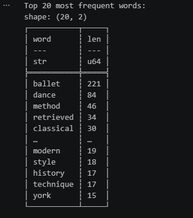
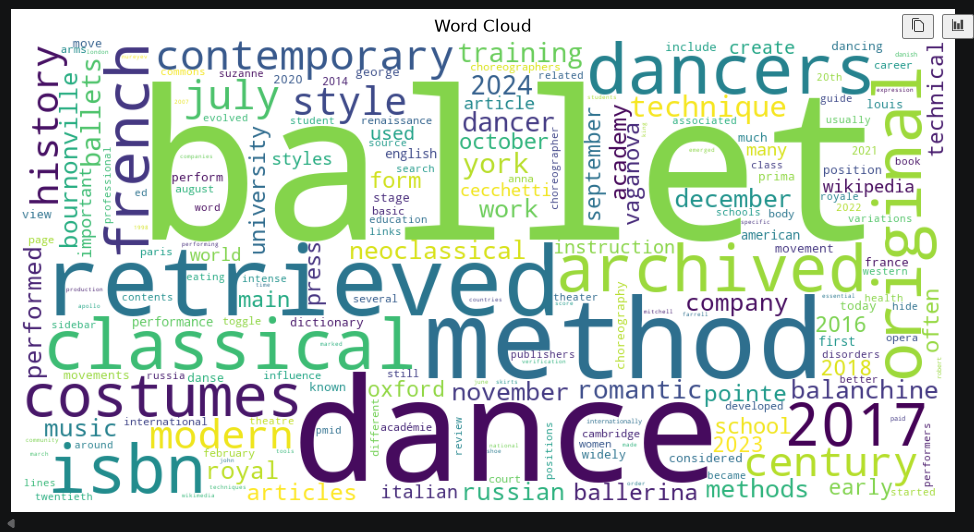

# Web Mining and Applied NLP Project Report

Web Mining and Applied NLP | Project 01 | Example Report

## Overview

This project establishes a professional Python environment
for acquiring and analyzing text from web pages.

The objective is to demonstrate that a Python project can
retrieve web content, extract text, compute word frequencies,
and produce visualizations using a reproducible workflow.

## Tools and Methods

The project uses:

- Python for text acquisition and analysis.
- Requests for retrieving HTML from web pages.
- BeautifulSoup for parsing HTML and extracting text.
- Polars for computing word frequencies.
- Matplotlib for frequency visualizations.
- WordCloud for visual exploration of vocabulary. Stop words added to remove filler words.
- Logging for execution records.
- Ruff, ty, and pytest for code verification.
- Zensical and GitHub Pages for published documentation.

The example script retrieves a Wikipedia article,
extracts text, cleans words,
and calculates token frequencies.

The analysis produces a frequency bar chart
and a word cloud.

## Custom Modifications

Stop words were added to the import wordcloud to remove
filler words that hold less value in analysis from the
analysis. Section 5 and six were updated to remove stop
words from the count of the Top 20.
The results did reflect more robust and
valuable language returns to the wordcloud and
bar chart visuals. The title of the bar chart
was updated to reflect the appropriate addition
of stop words removed.

## Verification

A successful execution displays:

    Pipeline executed successfully!

The script records execution details in a project log.

These results demonstrate that the environment can
retrieve, process, and visualize web text.

Automated tests provide additional verification
of the project's expected behavior.

## Interpretation

Web text contains both useful information and noise
introduced by document structure and formatting.

Simple text cleaning and frequency analysis
provide an initial view of a document's vocabulary
removing stop words, or filler words, to provide
more concise analysis of more meaningful words.

These techniques establish a foundation
for later work involving text preprocessing,
corpus exploration, and natural language processing.

# Custom Project-NLP Ballet Source Site

## Data Source

The data comes from a wikipedia site search for the term, ballet.
https://en.wikipedia.org/wiki/Ballet

## Purpose and Goal

Question is posed to identify key words
when searching the performance art, ballet,
while eliminating filler words such as 'the'
or 'and' to reduce saturation and distortion.

## Techniques and Methods

Added stop word to the import section for
word cloud. Adjusted the title on the bar
chart to note the removal of stop words.
Added code to both the python and notebook files
to remove the stop words from the cleaning step in section
5 and polars frame in section 6.

## Results

The results populate a table of the top 20
highest frequency words, a bar chart of the top
10 highest frequency words and a word cloud. Ballet
is the highest frequency word utilized in this search.

[Bar Chart](image-1.png)

## Limitations

This word search could present distortions in searching
the term ballet as such a global term that you might expect
the high volume of that word inside the article. Drawing more
specific insight may require the exclusion of that word or perhaps
visit a more specific site to draw more detailed conclusions.
It is especially notable that ballet was used so frequently with
the additional words seeming to drop immediately in volume and plateau.
That may be a sign that you need a more granular site to conduct this type
of NLP for this subject.

## Recommendations

Find a site that is more specific in it's original search to dive
deeper into what type of ballet, or area in the world. Specific
time period searches may be beneficial. Broad searches and sites
may be a key learning objective in this project to help show the
value of the site you are using and what the purpose of the project
really is to determine what source is best.

## Documentation Index

- **Home** - this landing page
- [**Project Instructions**](project-instructions.md)
- [**Glossary**](glossary.md)

## Project Links

- [GitHub Repository](https://github.com/denisecase/nlp-01-getting-started)
- [Example Script](https://github.com/denisecase/nlp-01-getting-started/blob/main/src/nlp/web_words.py)
- [Example Notebook](https://github.com/denisecase/nlp-01-getting-started/blob/main/notebooks/web_words.ipynb)

## Project Resources

- [Project Instructions](project-instructions.md)
- [Professional Python Guide](https://denisecase.github.io/pro-analytics-02/)
- [Professional Python Project Explainer](https://pup-pack.github.io/professional-python-project-explainer/)
